# mmWave 毫米波雷达融合实现流程

> 代码依据：`firmware/esp32-csi-node/main/mmwave_sensor.{c,h}`、`mmwave_detect.h`、
> `edge_processing.{c,h}`（ADR-063）；服务器侧 `v2/crates/wifi-densepose-sensing-server/src/main.rs`。
>
> **一句话总结**：毫米波融合发生在 **ESP32 固件边缘**（固定 80/20 加权），
> 产出一条独立的 `edge_fused_vitals` 广播；而服务器的**认证生命体征路径是纯 WiFi CSI**，
> 两者互不相干。

---

## 1. 总体数据流（两张并行的路径）

```mermaid
flowchart TD
    subgraph CSI["WiFi CSI 路径（认证用）"]
        A1[ESP32 采集 CSI<br/>promiscuous 模式] --> A2[vital_signs.rs<br/>FFT 频谱分析]
        A2 --> A3[bootstrap 标定基线<br/>eigenvalue 人数判定]
        A3 --> A4["/api/v1/vital-signs<br/>认证块 + gates"]
    end

    subgraph MMW["mmWave 融合路径（独立，未接入认证）"]
        B1[毫米波雷达<br/>MR60BHA2 / LD2410] --> B2[mmwave_sensor.c<br/>UART 帧解析]
        B2 --> B3[edge_processing.c<br/>80/20 加权融合]
        B3 --> B4["edge_fused_vitals 包<br/>magic 0xC5110004 · 48B"]
        B4 --> B5[服务器解析后广播<br/>edge_fused_vitals WS 消息]
    end

    A4 -. 无 mmwave 参与 .- X(( ))
    B5 -. 不进入认证门控 .- X

    style MMW fill:#2a3a4a,stroke:#5a9,stroke-width:1px
    style CSI fill:#1a2a3a,stroke:#4a8,stroke-width:1px
    style X fill:none,stroke:none
```



> ⚠️ 两条路径**只在固件里共享 CSI 心率/呼吸变量**（作为融合的 20% 权重），
> 服务器认证路径 `field_bridge.rs` / `vital_signs.rs` / `bootstrap_baseline.rs`
> 中 **mmwave 出现次数为 0**。

---

## 2. 开机自动探测雷达型号

固件启动时在 UART1（TX=17 / RX=18）上探测，**先验证完整帧再认型号**（防止浮动串口噪声误判，#1107/#1135）。

```mermaid
flowchart TD
    S[app_main 启动] --> P[mmwave_sensor_init<br/>探测 UART1]
    P --> B1[波特率 115200<br/>尝试 MR60BHA2]
    B1 --> V1{完整帧校验通过?<br/>SOF 0x01 + 类型 + 校验}
    V1 -->|是| T1[MMWAVE_TYPE_MR60BHA2<br/>能力: 心率+呼吸+存在]
    V1 -->|否| B2[波特率 256000<br/>尝试 LD2410]
    B2 --> V2{完整帧校验?<br/>头 F4F3F2F1 + 长度 + 尾 F8F7F6F5}
    V2 -->|是| T2[MMWAVE_TYPE_LD2410<br/>能力: 存在+测距]
    V2 -->|否| NONE[MMWAVE_TYPE_NONE<br/>CSI-only 模式<br/>本次实验即此分支]

    T1 --> TASK[启动后台解析任务<br/>更新 mmwave_state_t]
    T2 --> TASK
    TASK --> RUN[持续解析帧<br/>心跳/呼吸/存在/距离/目标数]

    style NONE fill:#4a2a2a,stroke:#c66
    style TASK fill:#1a3a2a,stroke:#6a9
```



校验谓词 `mmwave_detect.h` 是纯函数（可在主机单测）：
- **LD2410**：要求头 magic `F4 F3 F2 F1` + 合理帧长（1–64）+ 匹配尾 `F8 F7 F6 F5`。
  仅含头字节的线噪声会因尾校验失败被拒。
- **MR60BHA2**：SOF `0x01` + 帧类型（`0x0A14` 呼吸 / `0x0A15` 心率）+ 校验。

---

## 3. 边缘融合决策（每帧）

每帧边缘生命体征发送前，检查雷达是否在线，**在线则改发融合包**。

```mermaid
flowchart TD
    F["边缘生命体征帧<br/>CSI 心率 s_heartrate_bpm<br/>CSI 呼吸 s_breathing_bpm"] --> Q{"mmwave_sensor_get_state<br/>且 detected ?"}

    Q -->|"否 · 无雷达"| STD["发送标准 32B 包<br/>magic 0xC5110002"]
    Q -->|"是 · 有雷达"| FP["构造 edge_fused_vitals_pkt_t<br/>48 字节"]

    FP --> FLAG["置位 flags bit3<br/>0x08 = mmwave_present"]
    FLAG --> HR

    subgraph HR["心率融合（呼吸同理）"]
        H1{"mmWave 心率 与<br/>CSI 心率 均有效 ?"}
        H1 -->|"两者都有"| H2["加权平均<br/>fused = 0.8·mmWave + 0.2·CSI<br/>fusion_confidence = 90"]
        H1 -->|"仅 mmWave"| H3["fused = mmWave<br/>fusion_confidence = 85"]
        H1 -->|"仅 CSI"| H4["fused = CSI<br/>fusion_confidence = 50"]
    end

    HR --> RAW["附加原始 mmWave 值<br/>hr_bpm / br_bpm / distance<br/>targets / confidence / type"]
    RAW --> SEND["stream_sender_send<br/>48B 融合包"]
    STD --> UDP["UDP → 192.168.1.x : 5005"]
    SEND --> UDP

    style H2 fill:#1a3a2a,stroke:#6a9
    style STD fill:#2a2a3a,stroke:#66a
```



固定权重说明：代码注释称 "Kalman-style"，但**实际是固定 80/20 加权平均**，
无卡尔曼增益、无协方差更新——是个简化实现。
`mmwave_confidence` 取值：`frame_count > 10 ? 80 : 40`（刚启动时较低）。

---

## 4. 服务器侧接收与分发

```mermaid
flowchart TD
    UDP[UDP 收包<br/>port 5005] --> M{magic 识别}

    M -->|"0xC5110002"| P2[parse 32B 标准<br/>edge vitals]
    M -->|"0xC5110004"| PF[parse_edge_fused_vitals<br/>48B 融合包]
    M -->|"0xC5110007"| PW[WASM 输出包<br/>#928 重分配的 magic]

    PF --> JSON["组装 JSON<br/>type: edge_fused_vitals<br/>融合 br/hr + n_persons<br/>fusion_confidence<br/>+ 原始 mmwave 块"]
    JSON --> TX[tx.send → WebSocket 广播]

    P2 --> LV[latest_vitals<br/>喂给认证路径]
    PW --> WV[WASM 处理]

    style PF fill:#2a3a4a,stroke:#5a9
    style LV fill:#1a2a3a,stroke:#4a8
```



关键点：**融合包解析必须排在 WASM 解析器之前**（issue #928）——
两类包曾共用 magic，导致 WASM 解析器吞掉 C6+mmWave 配置下的融合帧。
解决方式：WASM magic 重分配为 `0xC5110007`，并加专用解析分支。

服务器**不修改、不门控**融合值，仅透传广播。原始 mmWave 值随包附带，
供"server-side analysis"（目前仅显示，未参与认证）。

---

## 5. 当前部署状态

| 项目 | 状态 |
|------|------|
| 固件驱动 | ✅ 已实现（MR60BHA2 + LD2410 自动探测） |
| 边缘融合 | ✅ 已实现（80/20 加权，48B 包） |
| 服务器解析广播 | ✅ 已实现（`edge_fused_vitals` WS） |
| 接入认证门控 | ❌ **未接入**（认证路径纯 CSI） |
| 当前板子接雷达 | ❌ **未接**（启动日志：`No mmWave sensor detected (CSI-only mode)`） |

启动日志实证（本次实验抓取）：

```
mmwave: Probing UART1 (TX=17, RX=18) for mmWave sensor...
mmwave: Probing at 115200 baud (MR60BHA2)...
mmwave: Probing at 256000 baud (LD2410)...
mmwave: No mmWave sensor detected on UART1
main:   No mmWave sensor detected (CSI-only mode)
```

---

## 6. 若需真正融合进认证路径（设计方向）

```mermaid
flowchart LR
    M[mmWave 原始值] --> D1[交叉验证<br/>presence 佐证<br/>eigenvalue 人数]
    M --> D2[参考基准<br/>校准 CSI 心率置信度]
    M --> D3[引入标定基线<br/>⚠️ 动隐私设计<br/>现仅落盘标量残差]
    D1 --> C[认证 vitals<br/>当前纯 CSI]
    D2 --> C
    D3 -.->|需谨慎| C

    style D3 fill:#4a3a2a,stroke:#c96
    style C fill:#1a2a3a,stroke:#4a8
```



复杂度递增：交叉验证（低）→ 置信度校准（中）→ 写入标定基线（高，涉隐私边界）。
